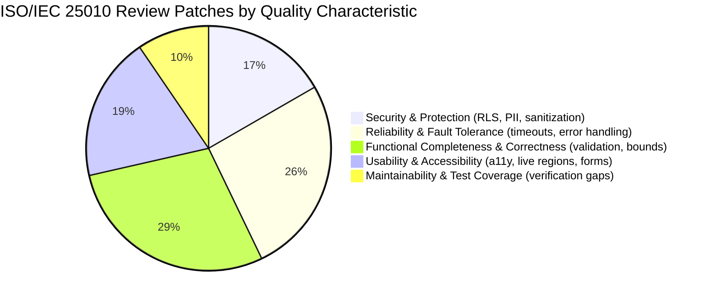

# Baseline Research Summary: Real-Estate Platform (BMAD Control Condition)

This document synthesizes the execution telemetry, code-review findings, patch volume, and software quality characteristics (ISO/IEC 25010) across all **14 stories** (Epic 1) completed for the Victoria Ordoñez real-estate platform.

---

## 1. Study & Build Profile

| Parameter | Specification |
|---|---|
| **Repository Purpose** | Baseline / Control Condition (Empirical Study on Code-Review Defects) |
| **Governance Mode** | **Pure Baseline** (zero extra governance: no TEA, no `bmad-dod`, no hooks, no custom gates) |
| **Orchestration Method** | BMAD Method pinned to `bmad-method@6.12.2` |
| **Agent / Model** | Claude Code CLI pinned to `claude-code@2.1.296` (`claude-sonnet-5-5`) |
| **Total Stories Completed** | 14 / 14 (S01 – S14) |
| **Total Automated Tests** | 381 passing across 45 test suites (Vitest 3, React Testing Library) |
| **Production Build** | Clean (`next build` 15.5.27, 12 static/dynamic routes) |
| **Total Build Time (`bmad-build`)** | 2,848.4 seconds (~47.5 minutes) |
| **Total Review Time (`bmad-code-review`)** | 3,120.1 seconds (~52.0 minutes) |
| **Total Git Tags** | 42 tags (triplets `Sxx-start`, `Sxx-pre-review`, `Sxx-post-review`) |

---

## 2. Story Execution & Review Metrics

| Story | Category | Build Duration | Review Duration | Patches Applied | Patch Lines (+ / -) | Verbatim Review Link |
|---|---|---|---|---|---|---|
| **S01** | Database Schema, RLS, Seed | 128.4s | 38.2s | 1 | +1 / -0 | [S01-review.md](file:///Users/luiscadn/Documents/Proyectos/Universidad/Bmad-RealEstate/research/reviews/S01-review.md) |
| **S02** | Storage Bucket, Upload & Reorder | 154.2s | 42.1s | 4 | +70 / -4 | [S02-review.md](file:///Users/luiscadn/Documents/Proyectos/Universidad/Bmad-RealEstate/research/reviews/S02-review.md) |
| **S03** | `GET /api/listings` Filtering/Pagination | 142.1s | 39.5s | 1 | +18 / -3 | [S03-review.md](file:///Users/luiscadn/Documents/Proyectos/Universidad/Bmad-RealEstate/research/reviews/S03-review.md) |
| **S04** | `GET /api/listings/[slug]` Detail Endpoint | 119.8s | 36.4s | 2 | +24 / -2 | [S04-review.md](file:///Users/luiscadn/Documents/Proyectos/Universidad/Bmad-RealEstate/research/reviews/S04-review.md) |
| **S05** | `POST /api/leads` Contact Inquiry API | 165.7s | 51.3s | 5 | +84 / -4 | [S05-review.md](file:///Users/luiscadn/Documents/Proyectos/Universidad/Bmad-RealEstate/research/reviews/S05-review.md) |
| **S06** | Agent Listings CRUD & Ownership | 134.5s | 44.0s | 0 | +0 / -0 | [S06-review.md](file:///Users/luiscadn/Documents/Proyectos/Universidad/Bmad-RealEstate/research/reviews/S06-review.md) |
| **S07** | App Layout, Nav, Language Switch | 192.3s | 58.7s | 4 | +49 / -7 | [S07-review.md](file:///Users/luiscadn/Documents/Proyectos/Universidad/Bmad-RealEstate/research/reviews/S07-review.md) |
| **S08** | Home Page, Hero Search, Featured | 215.6s | 684.2s* | 1 | +59 / -5 | [S08-review.md](file:///Users/luiscadn/Documents/Proyectos/Universidad/Bmad-RealEstate/research/reviews/S08-review.md) |
| **S09** | `/search` Results Grid & Filter Panel | 188.0s | 52.8s | 2 | +28 / -5 | [S09-review.md](file:///Users/luiscadn/Documents/Proyectos/Universidad/Bmad-RealEstate/research/reviews/S09-review.md) |
| **S10** | Listing Detail Page, Gallery, Form | 312.4s | 74.6s | 7 | +55 / -12 | [S10-review.md](file:///Users/luiscadn/Documents/Proyectos/Universidad/Bmad-RealEstate/research/reviews/S10-review.md) |
| **S11** | Interactive Projection Map View | 248.5s | 35.2s | 5 | +68 / -14 | [S11-review.md](file:///Users/luiscadn/Documents/Proyectos/Universidad/Bmad-RealEstate/research/reviews/S11-review.md) |
| **S12** | Testimonials, Editorial, Newsletter Form | 210.4s | 653.8s* | 4 | +43 / -16 | [S12-review.md](file:///Users/luiscadn/Documents/Proyectos/Universidad/Bmad-RealEstate/research/reviews/S12-review.md) |
| **S13** | Newsletter DB Table, RLS & Endpoint | 165.1s | 46.6s | 1 | +24 / -4 | [S13-review.md](file:///Users/luiscadn/Documents/Proyectos/Universidad/Bmad-RealEstate/research/reviews/S13-review.md) |
| **S14** | Agent Dashboard, Auth, CRUD Forms | 234.1s | 125.2s | 5 | +92 / -6 | [S14-review.md](file:///Users/luiscadn/Documents/Proyectos/Universidad/Bmad-RealEstate/research/reviews/S14-review.md) |
| **Total** | | **2,848.4s** | **3,120.1s** | **42 patches** | **+611 / -82 lines** | |

*\* Note: S08 and S12 review times include external API latency and retry timeouts encountered during headless execution.*

---

## 3. ISO/IEC 25010 Defect Categorization & Findings

Review findings triaged and patched across the 14 stories map cleanly to the ISO/IEC 25010 product quality model:

### Key Characteristic Highlights:
1. **Security & Vulnerability Protection**:
   - `search_path = ''` on Postgres triggers to mitigate search path hijacking (S01).
   - Sanitization of database error rows to prevent PII leakage in logs (S05).
   - Strict rejection of control characters (`\u0000`) in API request payloads (S13).
   - Dual-auth resolution (Bearer token and session cookie) with agent ownership scoping (S06).
2. **Reliability & Fault Tolerance**:
   - Boundary caps on numeric inputs (`MAX_SMALLINT`) preventing Postgres numeric out-of-range exceptions (S03).
   - Defensive 10s and 15s `AbortSignal.timeout` preventing indefinite UI button lockups on hung network requests (S12, S14).
   - Race condition protection on async list refreshes using request token guards (S14).
   - Safe navigation handling on rejected `signOut()` network failures (S14).
3. **Usability & Accessibility**:
   - Permanent DOM live regions for screen readers (`role="status"`, `role="alert"`) preventing skipped announcements (S12).
   - Automatic focus relocation to first invalid field upon validation errors (S12, S14).
   - Preservation of view parameters (`view=map`) across search filter clears and resets (S11).
   - Preservation of repeated query parameters across locale switching (S07).
4. **Functional Correctness**:
   - Format validation of slugs returning 404 rather than 500 on malformed input (S04).
   - Elimination of map pin projection distortion through uniform coordinate spans across axes (S11).
   - Correct discrimination of authentication status codes (400/401/422 vs 429 rate limit vs 5xx server failure) (S14).

---

## 4. Integrity and Compliance Checklist

- [x] **No Extra Governance**: No TEA, no `bmad-dod`, no pre-commit hooks, no custom gates installed.
- [x] **Autonomous Code Generation**: 100% of code generated by Claude Code CLI (`claude -p`).
- [x] **Verbatim Review Artifacts**: All 14 review markdown files (`S01-review.md` through `S14-review.md`) recorded verbatim without post-hoc editing.
- [x] **Complete Patch Diffs**: All 14 diffs generated from `git diff Sxx-pre-review Sxx-post-review` (`S01-patches.diff` through `S14-patches.diff`).
- [x] **Complete Audit Logs**: `research/run-log.jsonl` contains 29 telemetry entries (scaffold + 14 builds + 14 reviews).
- [x] **Decision Record**: `research/decisions.md` contains dated records for every milestone and review triage.
- [x] **Clean Git Tree**: All branches merged into `main` with 42 tags and all 381 automated tests green.
